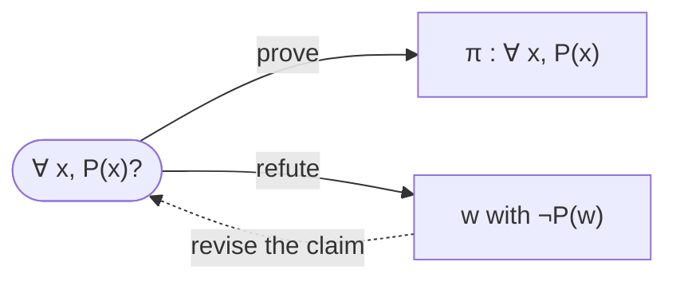

## こんにちは / 你好 / Hello! 👋

I’m a mathematics PhD student at the [National University of Singapore](https://www.math.nus.edu.sg/about/) (office S17-05-23). I started with pen-and-paper proofs and now work on machine learning for mathematical reasoning and discovery.

<strong>1 open goal</strong> &nbsp; <code>⊢ human + AI &gt; AI</code>

Give two agents the same conjecture. One tries to prove it while the other looks for a counterexample.

If the search returns `w` and `hw : ¬ P w`, then `fun h => hw (h w)` is a Lean proof that the conjecture is false.

### Research

- **Formal theorem proving** with language models, [Lean 4](https://lean-lang.org/), and [mathlib](https://github.com/leanprover-community/mathlib4).
- **Evaluator-guided search** for mathematical examples and formulas. [AlphaEvolve](https://deepmind.google/blog/alphaevolve-a-gemini-powered-coding-agent-for-designing-advanced-algorithms/) · [ASYS](https://github.com/scaling-group/ASYS-PDE)
- **Research workflows** in which agents pursue different approaches to the same problem and share their results. [EvE](https://github.com/scaling-group/eve)
