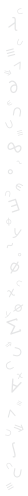
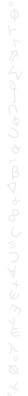

<picture><source media="(max-width: 540px)" srcset="assets/top-mobile.svg"></picture>

<picture><source media="(max-width: 540px)" srcset="assets/left-mobile.svg"></picture><picture><source media="(max-width: 540px)" srcset="assets/right-mobile.svg"></picture>

<h3>こんにちは / 你好 / Hello!&nbsp;&#8288;<picture><source media="(prefers-reduced-motion: reduce)" srcset="assets/waving-hand.png"></picture></h3>

I am a PhD student in Mathematics at [NUS, Singapore](https://www.math.nus.edu.sg/about/) (Office: S17-05-23). I began in pen-and-paper, and now work on machine learning and AI for mathematics.

### Research

- Lean 4 / mathlib / formal theorem proving
- Agentic systems for mathematical reasoning and discovery (e.g. Team S17 on [SAIR IGP24 Comp](https://competition.sair.foundation/competitions/igp24/leaderboard))
- evaluator-guided search (e.g. AlphaEvolve, [EvE](https://github.com/scaling-group/eve), [ASYS](https://github.com/scaling-group/ASYS-PDE))
- agentic research workflows

<picture><source media="(max-width: 540px)" srcset="assets/bottom-mobile.svg"></picture>

