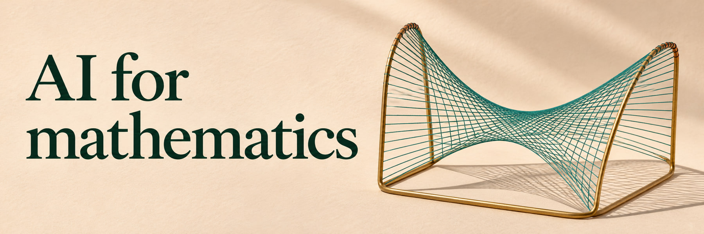

<picture>
  <source media="(prefers-color-scheme: dark)" srcset="./assets/mathematics-dark.jpg">
  <source media="(prefers-color-scheme: light)" srcset="./assets/mathematics-light.jpg">
  
</picture>

## こんにちは / 你好 / Hello! 👋

I’m a mathematics PhD student at the [National University of Singapore](https://www.math.nus.edu.sg/about/) (office S17-05-23). I started with pen-and-paper proofs and now work on machine learning for mathematical reasoning and discovery.

<table>
  <thead>
    <tr>
      <th align="left" width="700">Research</th>
      <th align="left" width="220">Tools and examples</th>
    </tr>
  </thead>
  <tbody>
    <tr>
      <td><strong>Formal theorem proving</strong> How language models find machine-checkable proofs.</td>
      <td><a href="https://lean-lang.org/">Lean 4</a> · <a href="https://github.com/leanprover-community/mathlib4">mathlib</a> · <a href="https://github.com/Jun2028/ProofConf">ProofConf</a></td>
    </tr>
    <tr>
      <td><strong>Evaluator-guided search</strong> Using mathematical tests to refine examples and formulas.</td>
      <td><a href="https://deepmind.google/blog/alphaevolve-a-gemini-powered-coding-agent-for-designing-advanced-algorithms/">AlphaEvolve</a> · <a href="https://github.com/scaling-group/ASYS-PDE">ASYS</a></td>
    </tr>
    <tr>
      <td><strong>Agentic research workflows</strong> How agents share partial results while pursuing different approaches to a problem.</td>
      <td><a href="https://github.com/scaling-group/eve">EvE</a></td>
    </tr>
  </tbody>
</table>
